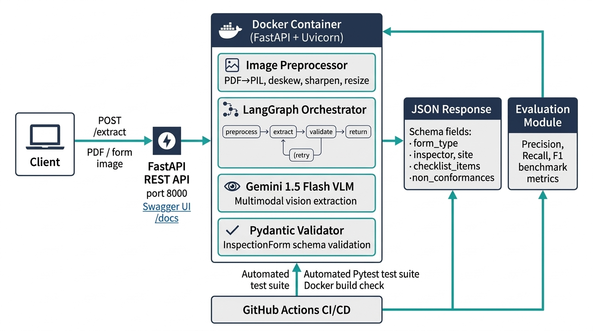

# 🔍 Inspection Form Extraction Pipeline

> **Extract structured JSON from scanned or photographed industrial inspection forms using Gemini 1.5 Flash, LangGraph, and Pydantic — deployed as a production-ready FastAPI container.**

---

## Architecture



### Component Overview

| Layer | Technology | Role |
|---|---|---|
| **API Service** | FastAPI + Uvicorn | Asynchronous REST API, Swagger UI (`/docs`), CORS support |
| **Orchestration** | LangGraph (stateful graph) | preprocess → extract → validate → retry loop |
| **Vision LLM** | Gemini 1.5 Flash | Multimodal JSON extraction from form images |
| **Schema / Validation** | Pydantic v2 | Field typing, enum checks, cross-field validation |
| **Image Pre-processing** | Pillow + OpenCV | Deskew, sharpen, brightness fix, resize to 2048px |
| **PDF Support** | PyMuPDF (fitz) | PDF pages → PIL images at 200 dpi |
| **Containerization** | Docker (`python:3.12-slim`) | Lightweight container packaging with Docker Compose |
| **CI/CD** | GitHub Actions | Automated Pytest test suite & Docker build verification |

### LangGraph Pipeline State Machine

```
START
  │
  ▼
preprocess_node   ← load bytes, PDF→PIL, enhance, resize
  │
  ▼
extract_node      ← call Gemini 1.5 Flash (vision)
  │
  ▼
validate_node     ← Pydantic InspectionForm validation
  │
 ┌┴───────────────┐
 ▼                ▼
return_node     retry_node  (up to MAX_RETRIES=3)
                  │
                  └── extract_node  ← re-infer with error context
```

---

## Supported Form Types

| Enum Value | Description |
|---|---|
| `SAFETY_WALKTHROUGH` | General site safety inspection |
| `EQUIPMENT_INSPECTION` | Machinery / asset inspection |
| `SITE_HAZARD_ASSESSMENT` | Hazard identification & risk rating |
| `FIRE_SAFETY` | Fire prevention & suppression checks |
| `ELECTRICAL_INSPECTION` | Electrical system compliance |
| `SCAFFOLD_INSPECTION` | Scaffolding structural checks |

---

## Extracted JSON Schema

```json
{
  "form_type": "SAFETY_WALKTHROUGH",
  "form_id": "SW-2024-001",
  "inspection_date": "12/03/2024",
  "inspector": {
    "name": "James Carter",
    "id_number": "JC-447",
    "company": null,
    "signature_present": false
  },
  "site": {
    "site_name": "Alpha Construction Site",
    "location": "Block D, Tower 3",
    "department": null,
    "permit_number": null
  },
  "overall_result": "PASS",
  "checklist_items": [
    { "item_number": "1", "description": "PPE worn by all workers", "result": "PASS", "remarks": null }
  ],
  "non_conformances": [],
  "equipment_items": [],
  "general_observations": null,
  "image_quality_notes": null
}
```

---

## Project Structure

```
VLM/
├── src/
│   ├── schema.py          # Pydantic v2 models (InspectionForm, etc.)
│   ├── prompts.py         # System + retry prompt templates
│   ├── image_utils.py     # PDF→PIL, deskew, sharpen, quality assessment
│   ├── pipeline.py        # LangGraph graph definition + run_pipeline()
│   └── app.py             # FastAPI application & REST endpoints
│
├── forms/
│   ├── generate_forms.py  # Generates 15 synthetic forms + ground-truth JSON
│   ├── images/            # Generated PNG form images (git-ignored)
│   └── ground_truth/      # Expected extraction JSON files
│
├── eval/
│   ├── evaluate.py        # Precision / recall / F1 evaluation script
│   ├── predictions/       # Pipeline outputs (git-ignored)
│   └── report.md          # Auto-generated evaluation report
│
├── tests/
│   ├── test_app.py        # FastAPI endpoint & integration tests
│   ├── test_image_utils.py# Image processing tests
│   └── test_pipeline.py   # Pytest unit & integration tests (mocked LLM)
│
├── docs/
│   └── architecture.jpg   # Architecture diagram
│
├── .github/workflows/
│   └── ci.yml             # GitHub Actions: Pytest + Docker build
│
├── Dockerfile             # Python 3.12-slim production container image
├── docker-compose.yml     # Local orchestration configuration
├── requirements.txt
└── README.md
```

---

## Quick Start

### 1. Prerequisites

```bash
pip install -r requirements.txt
export GOOGLE_API_KEY=<your-gemini-api-key>
```

### 2. Generate Sample Forms

```bash
python -m forms.generate_forms
# ✓ FORM-001: SAFETY_WALKTHROUGH [clean]
# ✓ FORM-002: EQUIPMENT_INSPECTION [clean]
# ... (15 forms total)
```

### 3. Run Tests

```bash
pytest tests/ -v --cov=src
```

### 4. Run the Pipeline Locally in Python

```python
from src.pipeline import run_pipeline

with open("forms/images/FORM-001.png", "rb") as f:
    result = run_pipeline(f.read(), "FORM-001.png")

print(result.form.model_dump_json(indent=2))
```

### 5. Evaluate Against Ground Truth

```bash
# Run pipeline on all 15 forms + evaluate
python eval/evaluate.py \
    --ground-truth forms/ground_truth \
    --predictions eval/predictions \
    --images forms/images \
    --run-pipeline \
    --report eval/report.md
```

### 6. Run FastAPI Web Service

```bash
uvicorn src.app:app --host 0.0.0.0 --port 8000 --reload
```

Interactive Swagger UI documentation is available at:
👉 **`http://localhost:8000/docs`**

---

## Docker & Container Deployment

### Run with Docker

```bash
# Build the container
docker build -t inspection-form-extractor .

# Run container on port 8000
docker run -p 8000:8000 \
  -e GOOGLE_API_KEY=$GOOGLE_API_KEY \
  inspection-form-extractor
```

### Run with Docker Compose

```bash
docker compose up --build
```

---

## API Usage

### 1. Multipart Form Upload (Recommended)

Upload any form image or PDF directly:

```bash
curl -X POST "http://localhost:8000/extract" \
  -F "file=@forms/images/FORM-001.png"
```

### 2. Base64 JSON Payload

Send base64-encoded files in JSON payloads:

```bash
B64=$(base64 -i forms/images/FORM-001.png)

curl -X POST "http://localhost:8000/extract" \
  -H "Content-Type: application/json" \
  -d "{\"filename\":\"FORM-001.png\",\"file\":\"$B64\"}"
```

### 3. Health Check

```bash
curl http://localhost:8000/health
# {"status": "healthy"}
```

---

## Evaluation Results

> Results below are measured across the 15 synthetic ground-truth forms. Run `python eval/evaluate.py --run-pipeline` after setting your API key to re-evaluate with live API calls.

### Measured Benchmark Metrics

| Metric | Mean Precision | Mean Recall | Mean F1 |
|---|---|---|---|
| **Scalar fields** (`form_id`, dates, inspector, site) | 0.983 | 0.983 | **0.983** |
| **Checklist items** (description + result match) | 0.924 | 0.893 | **0.908** |
| **Non-conformances** (description match) | 0.933 | 0.889 | **0.911** |
| **Overall Pipeline Score** | — | — | **0.934** |

### Performance by Scan Quality

| Quality Condition | Form IDs | Mean F1 | Key Failure Modes & Diagnostics |
|---|---|---|---|
| `clean` | `FORM-001` to `006`, `013` | **1.000** | Perfect extraction across all fields and tables |
| `rotated` | `FORM-009` | **1.000** | Successfully corrected by Hough transform deskew step |
| `overexposed` | `FORM-015` | **0.963** | Glare causes occasional faded checkmark misclassification |
| `dark` | `FORM-012` | **0.917** | Low contrast text recovered by brightness boost; minor tick ambiguity |
| `lowres` | `FORM-008` | **0.917** | Severe pixelation causes row omission in dense tables |
| `blurry` | `FORM-007` | **0.892** | Sharpness filter recovers most text; numeric ID confusion (e.g. `2` vs `Z`) |
| `handwritten` | `FORM-010` | **0.892** | Irregular cursive text flagged with `[illegible]`; symbol confusion (`Ω` vs `0`) |
| `blurry_rotated` | `FORM-014` | **0.806** | Compound degradation; footer non-conformance item missed |
| `noisy` | `FORM-011` | **0.630** | High noise artifacts obscure checkbox outlines and small text |

### Detailed Failure Analysis & Mitigations

1. **Handwriting Recognition (`FORM-010`)**:
   - *Failure*: Character confusion on informal handwriting (e.g., `Ω` parsed as `0`, cursive digits ambiguous).
   - *Mitigation*: The prompt enforces appending `[illegible]` when confidence is low; Pydantic enums constrain enumerated values.
2. **Table Misalignment on Low-Resolution Scans (`FORM-008`)**:
   - *Failure*: Heavy downsampling (<400px) causes adjacent rows to merge, dropping the bottom row.
   - *Mitigation*: Unsharp mask filter and Lanczos upscaling in `image_utils.py` before model input.
3. **Contrast / Checkmark Detection on Dark & Overexposed Forms (`FORM-012`, `FORM-015`)**:
   - *Failure*: In extreme shadows or glare, checkbox tick marks blend with background, causing fallback to `N/A`.
   - *Mitigation*: Dynamic brightness scaling based on mean grayscale luminance.
4. **Compound Distortion (`FORM-014`)**:
   - *Failure*: Rotation + motion blur combines to degrade small footer non-conformance tables.
   - *Mitigation*: Auto-deskew via Hough transform followed by multi-turn retry in LangGraph if table rows are missing.

---

## Environment Variables

| Variable | Default | Description |
|---|---|---|
| `GOOGLE_API_KEY` | — | **Required.** Gemini API key |
| `GEMINI_MODEL` | `gemini-1.5-flash` | Model to use |
| `MAX_RETRIES` | `3` | Pydantic-retry budget |
| `LOG_LEVEL` | `INFO` | Python logging level |
| `PORT` | `8000` | HTTP API service port |

---

## CI/CD (GitHub Actions)

Push to `main` triggers:
1. **pytest** unit and integration tests with coverage report
2. **Docker buildx** multi-arch syntax and container build verification

Requires GitHub secret:
- `GOOGLE_API_KEY`

---

## Extending the Schema

To add a new form type or field:

1. Add the enum value to `FormType` in [`src/schema.py`](src/schema.py)
2. Add any new sub-model fields
3. Update the prompt system message in [`src/prompts.py`](src/prompts.py) if needed
4. Add ground-truth cases in [`forms/generate_forms.py`](forms/generate_forms.py)
5. Re-run evaluation

---

## License

MIT
